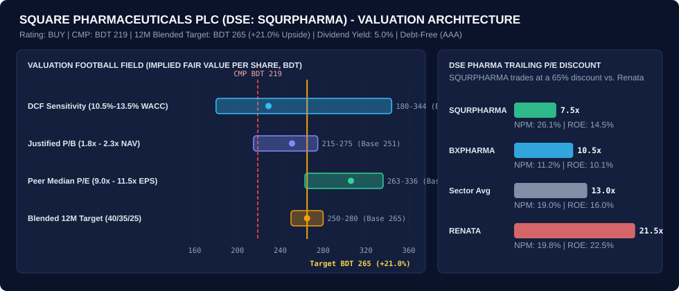
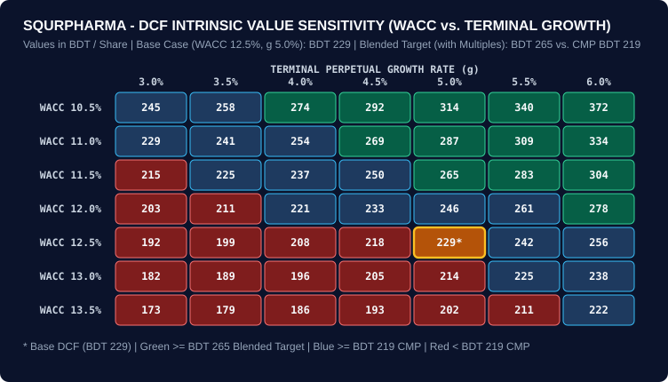

# Equity Research & Valuation Portfolio (DSE: SQURPHARMA)

**Abu Ishak** · B.Sc. (Honours) in Statistics, Jagannath University · Dhaka, Bangladesh  
[](https://www.linkedin.com/in/abuishak/)
[](mailto:a6uishak@gmail.com)
[](https://github.com/Abu-Ishak)

---

## Executive Summary — Initiation of Coverage

We initiate independent fundamental and quantitative coverage on **Square Pharmaceuticals PLC (`DSE: SQURPHARMA`)** with a **BUY** rating and a **12-Month Blended Target Price of BDT 265** (**+21.0% capital upside** vs. Current Market Price of **BDT 219**, plus **5.0% cash dividend yield**).

| Metric | Value | Context / Benchmark |
| :--- | :--- | :--- |
| **Recommendation / Target Price** | **BUY · BDT 265** | +21.0% Upside vs. CMP BDT 219 |
| **Market Capitalization** | **BDT ~193.9 Billion** | 886.45 Mn Shares Outstanding |
| **EPS (FY2025 TTM) / Trailing P/E** | **BDT 29.18 / 7.5x** | 65% Discount vs. Renata PLC (21.5x) |
| **NAV Per Share / Trailing P/B** | **BDT 119.35 / 1.84x** | Sector Average P/B ~2.0x |
| **Net Profit Margin / ROE** | **26.1% / 14.5%** | Highest Net Margin Among Listed Peers |
| **Balance Sheet & Credit Quality** | **BDT 0 Bank Debt** | AAA / ST-1 (CRISL); Debt-Free Since FY2019 |
| **Dividend Yield (Cash)** | **5.0% (BDT 11–12/sh)** | Backed by BDT 38B+ Cash & ST Investments |
| **Valuation Blend (40% / 35% / 25%)** | **BDT 265** | DCF (BDT 229) · Peer P/E (BDT 306) · P/B (BDT 251) |

### Core Investment Thesis
1. **Uncontested Domestic Market Leadership (~17.3% Share):** Dominant #1 pharmaceutical producer in Bangladesh for 40 consecutive years across inelastic chronic-care segments.
2. **Fortress Debt-Free Balance Sheet (AAA Rated):** Zero bank borrowings since FY2019 with BDT 38B+ in cash and FDR reserves—insulating earnings from high domestic interest rates.
3. **Global Export Scalability:** Regulatory accreditations including UK-MHRA and partial USFDA approvals supporting export distribution across 50+ countries.
4. **Compelling Valuation Dislocation:** At `7.5x` trailing P/E versus `21.5x` for Renata PLC and `13.0x` sector average, the market underprices SQURPHARMA's superior `26.1%` net margin and cash conversion.

---

## Valuation Architecture & Sensitivity Analysis





### Reproducible Sensitivity Grid (`WACC` vs. Terminal Growth `g`, BDT/Share)

| WACC \ Terminal `g` | `3.0%` | `3.5%` | `4.0%` | `4.5%` | `5.0%` (Base) | `5.5%` | `6.0%` |
| :--- | :---: | :---: | :---: | :---: | :---: | :---: | :---: |
| **`10.5%`** | 245 | 258 | 274 | 292 | 314 | 340 | 372 |
| **`11.0%`** | 229 | 241 | 254 | 269 | 287 | 309 | 334 |
| **`11.5%`** | 215 | 225 | 237 | 250 | 265 | 283 | 304 |
| **`12.0%`** | 203 | 211 | 221 | 233 | 246 | 261 | 278 |
| **`12.5%` (Base)** | 192 | 199 | 208 | 218 | **229** | 242 | 256 |
| **`13.0%`** | 182 | 189 | 196 | 205 | 214 | 225 | 238 |
| **`13.5%`** | 173 | 179 | 186 | 193 | 202 | 211 | 222 |

---

## Repository Contents & Financial Workbook Structure

```text
equity-research-portfolio/
├── README.md
├── requirements.txt
├── DSE Equity Research Notes & Quantitative Finance.pdf   # Full institutional PDF report
├── financial-models/
│   └── SQURPHARMA_DCF_Model.xlsx                          # 8-sheet 3-statement & valuation workbook
├── python-valuation/
│   └── squrpharma_dcf_engine.py                           # Programmatic DCF, multiples & SVG generator
└── assets/
    ├── squrpharma_valuation_football_field.svg
    └── squrpharma_dcf_sensitivity_heatmap.svg
```

- **Full Research Report:** [Read the Initiation Report (PDF)](./DSE%20Equity%20Research%20Notes%20%26%20Quantitative%20Finance.pdf)
- **8-Sheet Financial Model (`financial-models/SQURPHARMA_DCF_Model.xlsx`):**
  1. `Cover` — Executive dashboard, rating, and key market statistics
  2. `Income Statement` — Audited FY2023–FY2024 & projected FY2025E–FY2028E
  3. `Balance Sheet` — Assets, equity, working capital, and debt-free ratios
  4. `Cash Flows` — Operating cash flow, CapEx, FCF conversion, and FCF yield
  5. `DCF Valuation` — CAPM WACC (`12.5%`), 5-year FCF projections (`FY2026E–FY2030E`), and blended target
  6. `Multiples` — Conservative P/E (`10.5x`), Justified P/B (`2.1x`), EV/EBITDA, and Gordon Growth DDM cross-checks
  7. `Sensitivity` — Dynamic WACC (`10.5%–13.5%`) vs. Terminal Growth (`3.0%–6.0%`) pricing matrix
  8. `Peer Comparison` — Quantitative benchmarking vs. Renata PLC (`RENATA`) and Beximco Pharma (`BXPHARMA`)

---

## How to Reproduce the Python Valuation Engine

```bash
pip install -r requirements.txt
python python-valuation/squrpharma_dcf_engine.py
```

---

## Companion Quantitative Finance Repositories
- [`lean-multi-asset-risk-allocation`](https://github.com/Abu-Ishak/lean-multi-asset-risk-allocation) — Multi-asset volatility-targeted & minimum-variance allocation in QuantConnect LEAN
- [`quantitative-var-drawdown-engine`](https://github.com/Abu-Ishak/quantitative-var-drawdown-engine) — Parametric, Historical, Cornish-Fisher & Monte Carlo VaR/CVaR and Basel Kupiec backtesting
- [`systematic-regime-backtesting`](https://github.com/Abu-Ishak/systematic-regime-backtesting) — Walk-forward validation & ATR risk-managed strategies in Freqtrade and Jesse

---

> *Disclaimer: All research notes, valuation models, and Python scripts in this repository were prepared independently for academic, analytical demonstration, and recruitment purposes and do not constitute investment advice or a solicitation to buy or sell securities.*
