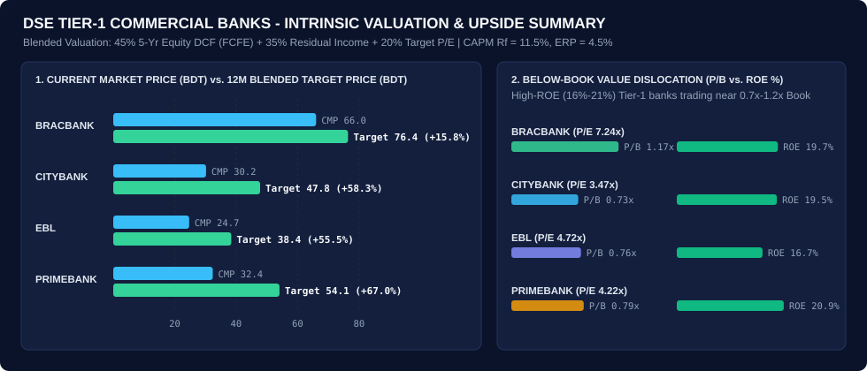
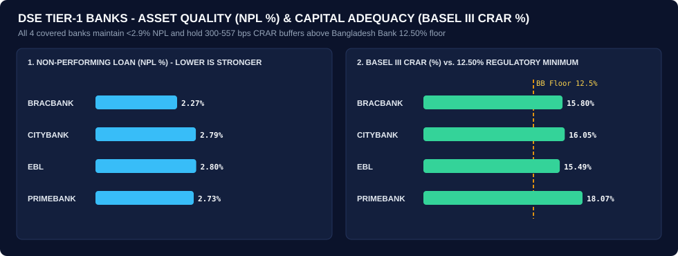

# DSE Equity Research & Intrinsic Valuation Portfolio — Banking & Pharmaceuticals

**Abu Ishak** · B.Sc. (Honours) in Statistics, Jagannath University · Dhaka, Bangladesh  
[](https://www.linkedin.com/in/abuishak/)
[](mailto:a6uishak@gmail.com)
[-059669?style=flat)](https://github.com/Abu-Ishak/equity-research-portfolio)
[](https://github.com/Abu-Ishak)

---

## 5-Stock Dhaka Stock Exchange (DSE) Initiation Coverage Summary

| Ticker & Report | Sector | Rating | CMP | 12M Target | Upside | Primary Valuation Framework |
| :--- | :--- | :---: | :---: | :---: | :---: | :--- |
| [`BRACBANK`](./research-notes/BRACBANK_Initiation_Note.md) | Commercial Banking | **BUY** | `BDT 66.0` | **`BDT 76.4`** | **`+15.8%`** | FCFE DCF (`45%`) · Residual Income (`35%`) · P/E (`20%`) |
| [`CITYBANK`](./research-notes/CITYBANK_Initiation_Note.md) | Commercial Banking | **BUY** | `BDT 30.2` | **`BDT 47.8`** | **`+58.3%`** | FCFE DCF (`45%`) · Residual Income (`35%`) · P/E (`20%`) |
| [`EBL`](./research-notes/EBL_Initiation_Note.md) | Commercial Banking | **BUY** | `BDT 24.7` | **`BDT 38.4`** | **`+55.5%`** | FCFE DCF (`45%`) · Residual Income (`35%`) · P/E (`20%`) |
| [`PRIMEBANK`](./research-notes/PRIMEBANK_Initiation_Note.md) | Commercial Banking | **BUY** | `BDT 32.4` | **`BDT 54.1`** | **`+67.0%`** | FCFE DCF (`45%`) · Residual Income (`35%`) · P/E (`20%`) |
| [`SQURPHARMA`](./DSE%20Equity%20Research%20Notes%20%26%20Quantitative%20Finance.pdf) | Pharmaceuticals | **BUY** | `BDT 219.0` | **`BDT 265.0`** | **`+21.0%`** | FCFF DCF (`40%`) · Peer P/E (`35%`) · P/B (`25%`) |

---

## Section 1: DSE Tier-1 Commercial Banking Coverage (4 Banks)

> **Why Banks Require Equity-Basis DCF & Residual Income:** Customer deposits are core operating funding rather than corporate debt, rendering `EV/EBITDA` and Unlevered `FCFF` inapplicable. All four banks are modeled using **5-Year Explicit Capital-Adjusted FCFE DCF** (deducting retained earnings needed to sustain Basel III CRAR buffers, discounted at CAPM $K_e = R_f + \beta \cdot \text{ERP}$ with `11.5%` 10Y BD Treasury yield and `4.5%` ERP), **Residual Income Valuation**, and **Conservative Forward P/E**.

- **Full 5-Page Banking Sector PDF:** [DSE Tier-1 Banking Equity Research & DCF Report (PDF)](./DSE_Tier1_Banking_Equity_Research.pdf)
- **6-Sheet Banking DCF Workbook:** [`financial-models/DSE_Banking_DCF_Valuation_Models.xlsx`](./financial-models/DSE_Banking_DCF_Valuation_Models.xlsx)
- **Individual Bank Initiation Notes:** [`BRACBANK`](./research-notes/BRACBANK_Initiation_Note.md) · [`CITYBANK`](./research-notes/CITYBANK_Initiation_Note.md) · [`EBL`](./research-notes/EBL_Initiation_Note.md) · [`PRIMEBANK`](./research-notes/PRIMEBANK_Initiation_Note.md)
- **Python Banking Valuation Engine:** [`python-valuation/dse_banking_dcf_engine.py`](./python-valuation/dse_banking_dcf_engine.py)





---

## Section 2: Pharmaceuticals Coverage — Square Pharmaceuticals PLC (`DSE: SQURPHARMA`)

Independent initiation on Bangladesh's #1 pharmaceutical manufacturer (`~17.3%` market share, zero bank debt since FY2019, `AAA / ST-1` credit rating, `50+` export markets, `7.5x` trailing P/E vs. Renata `21.5x`).

- **Full Initiation Report:** [Read the SQURPHARMA Report (PDF)](./DSE%20Equity%20Research%20Notes%20%26%20Quantitative%20Finance.pdf)
- **8-Sheet Corporate DCF Workbook:** [`financial-models/SQURPHARMA_DCF_Model.xlsx`](./financial-models/SQURPHARMA_DCF_Model.xlsx) (`Cover`, `Income Statement`, `Balance Sheet`, `Cash Flows`, `DCF Valuation`, `Multiples`, `Sensitivity`, `Peer Comparison`)
- **Python Corporate Valuation Engine:** [`python-valuation/squrpharma_dcf_engine.py`](./python-valuation/squrpharma_dcf_engine.py) (`WACC 12.5%`, `g = 5.0%` -> DCF `BDT 229`; Peer P/E `BDT 306`; P/B `BDT 251`; Blended Target **`BDT 265`**, `+21.0%` upside)


---

## Repository Structure & Reproduction

```text
equity-research-portfolio/
├── README.md
├── requirements.txt
├── DSE_Tier1_Banking_Equity_Research.pdf                  # 5-page Banking Sector Equity Research PDF
├── DSE Equity Research Notes & Quantitative Finance.pdf   # SQURPHARMA institutional PDF report
├── research-notes/
│   ├── BRACBANK_Initiation_Note.md
│   ├── CITYBANK_Initiation_Note.md
│   ├── EBL_Initiation_Note.md
│   └── PRIMEBANK_Initiation_Note.md
├── financial-models/
│   ├── DSE_Banking_DCF_Valuation_Models.xlsx              # 6-sheet Banking FCFE & Residual Income model
│   └── SQURPHARMA_DCF_Model.xlsx                          # 8-sheet 3-statement Corporate DCF model
├── python-valuation/
│   ├── dse_banking_dcf_engine.py                          # Banking FCFE, Residual Income & SVG generator
│   └── squrpharma_dcf_engine.py                           # SQURPHARMA DCF & sensitivity SVG generator
└── assets/
    ├── dse_banks_valuation_upside.svg
    ├── dse_banks_asset_quality_crar.svg
    ├── squrpharma_valuation_football_field.svg
    └── squrpharma_dcf_sensitivity_heatmap.svg
```

```bash
pip install -r requirements.txt
python python-valuation/dse_banking_dcf_engine.py
python python-valuation/squrpharma_dcf_engine.py
```

---

## Companion Quantitative Finance Repositories
- [`lean-multi-asset-risk-allocation`](https://github.com/Abu-Ishak/lean-multi-asset-risk-allocation) — Multi-asset volatility-targeted & minimum-variance allocation in QuantConnect LEAN
- [`quantitative-var-drawdown-engine`](https://github.com/Abu-Ishak/quantitative-var-drawdown-engine) — Parametric, Historical, Cornish-Fisher & Monte Carlo VaR/CVaR and Basel Kupiec backtesting
- [`systematic-regime-backtesting`](https://github.com/Abu-Ishak/systematic-regime-backtesting) — Walk-forward validation & ATR risk-managed strategies in Freqtrade and Jesse

> *Disclaimer: All research notes, Excel workbooks, PDFs, and Python models in this repository were prepared independently for academic, analytical demonstration, and recruitment purposes and do not constitute investment advice.*
